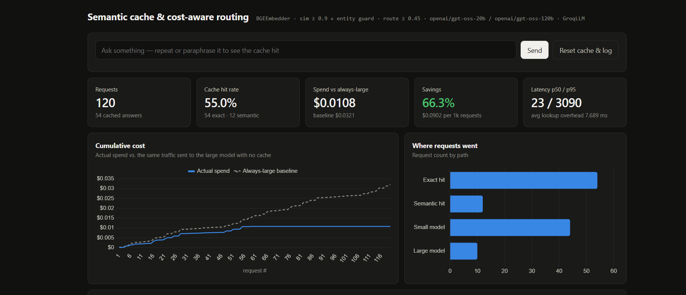
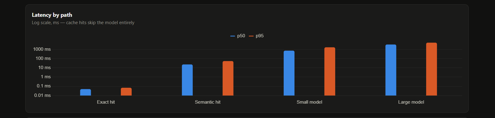
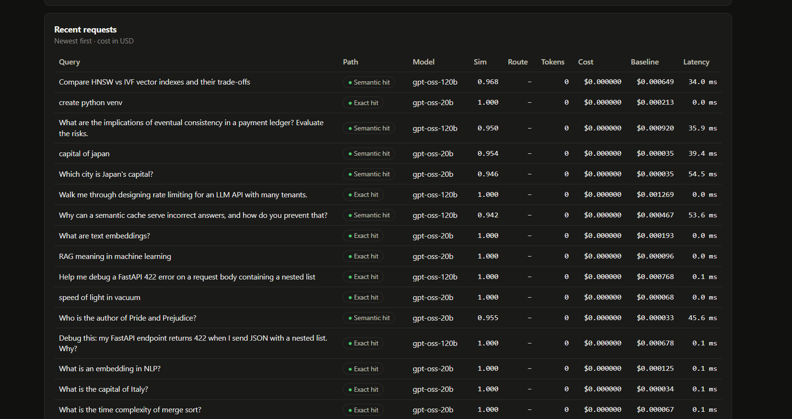
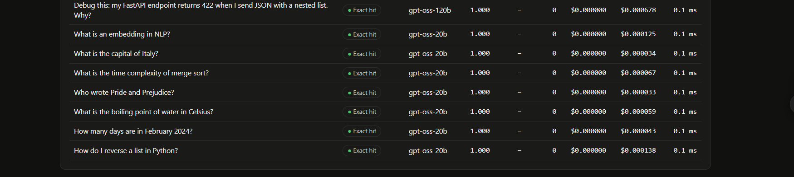

# semcache-router

A cost-control layer that sits in front of an LLM: it **reuses answers to questions it has already seen** (exact and paraphrased), **sends easy questions to a cheap model and hard ones to an expensive model**, and **logs cost and latency for every request** on a live dashboard — with a running comparison against what the same traffic would have cost with no cache and no router.






## Why this exists

In a RAG product the LLM call is the dominant per-request cost, and real traffic is repetitive: support bots, internal docs assistants and FAQ search see the same intents over and over, phrased differently. Two cheap decisions made *before* the LLM call decide whether the product is affordable at scale:

1. **Have we answered this already?** → serve from cache: $0, sub-millisecond.
2. **If not, how much model does it need?** → "what's the default Postgres port" doesn't need a 120B model.

The hard part isn't building either — it's not getting them **wrong**: a semantic cache that serves France's answer to a question about Germany, or a router that sends a subtle systems-design question to the small model, is worse than no layer at all. Most of this project is about measuring those failure modes.

## Architecture

```
query
  ├─ exact match on normalised text (hash) ───────────► cached answer   ~0.03 ms, no embedding
  ├─ embed once (bge-small-en-v1.5, 384-d)
  ├─ cosine ≥ threshold against cached queries
  │    └─ entity guard: same numbers / names? ────────► cached answer   ~5–15 ms on CPU
  ├─ router(query, embedding)
  │    ├─ heuristic: reasoning cues, code, math, length, multi-part
  │    └─ kNN vote over labelled examples (reuses the embedding — free)
  ├─ small model (gpt-oss-20b) or large model (gpt-oss-120b) via Groq
  ├─ store (query, embedding, answer, token counts)
  └─ log: path, model, tokens, cost, always-large baseline cost, latency
```

| File | What it does |
|---|---|
| `semcache/cache.py` | Two-tier cache, SQLite persistence + in-memory numpy index, TTL, namespaces, entity guard |
| `semcache/router.py` | `ComplexityRouter` (heuristic), `EmbeddingRouter` (kNN), `HybridRouter` |
| `semcache/gateway.py` | The pipeline above |
| `semcache/metrics.py` | Per-request log; savings, hit rate, p50/p95 per path |
| `semcache/llm.py` | Groq client + a mock backend so everything runs without a key |
| `semcache/api.py`, `dashboard.html` | FastAPI endpoints + live dashboard |
| `bench/` | Labelled workload, threshold sweep, router eval, traffic replay |

## Design decisions

- **Exact tier before semantic tier.** Repeats are the most common hit and need no embedding at all. Repeats are free to serve and safe by construction.
- **Brute-force numpy search instead of a vector DB.** A matmul over 100k × 384 floats is a few ms. HNSW (pgvector, as in my RAG project) is a drop-in for `SemanticCache.lookup_semantic` when the cache outgrows memory.
- **Entity guard.** Sentence embeddings are nearly blind to the single word that changes the answer: "capital of France" vs "capital of Germany", "HTTP 500" vs "HTTP 503", "Python 3.11" vs "3.12". A semantic hit is rejected if either query contains a number, quoted string or capitalised name that the other doesn't. Known gap: it can't catch lowercase common nouns ("reverse a *list*" vs "reverse a *string*") — the threshold has to handle those.
- **Namespaces.** In a RAG system an answer is only valid for the tenant and document set it was generated from, so the namespace is part of the cache key. If documents change, bump the namespace (or lower the TTL).
- **Conservative savings.** The baseline prices each request's actual tokens at large-model rates. When the small model answered, its reply is usually shorter than the large model's would have been, so the baseline is understated and reported savings are a lower bound.
- **Router reuses the cache embedding.** The kNN router costs one 96×384 matmul — routing adds no model call.

## Results

### 1. Cache: similarity threshold × entity guard

`python -m bench.run_bench` replays a hand-labelled workload of 192 requests / 48 intents with `bge-small-en-v1.5` embeddings:
- **paraphrase groups**: later paraphrases *should* hit the cache
- **near-miss groups**: look alike but need different answers (France/Germany, HTTP 500/503, Python 3.11/3.12, 15%/25% of 200). Any hit between them is a **false hit**, i.e. a wrong answer served to a user.
- a second pass re-asking everything, which is where exact hits come from

The LLM is mocked here, so hit rates, false hits and savings are real measurements of this code; model latency is not. Full output: [`bench/results.md`](bench/results.md).

| threshold | guard | true-hit rate | false hits | false-hit rate | savings | avg lookup |
|---|---|---|---|---|---|---|
| 0.80 | off | 83.3% | 33 | 21.6% | 86.3% | 8.5 ms |
| 0.80 | on | 82.6% | 12 | 9.2% | 76.5% | 7.1 ms |
| 0.85 | off | 87.5% | 18 | 12.5% | 83.9% | 7.8 ms |
| 0.85 | on | 86.1% | 2 | 1.6% | 75.6% | 7.0 ms |
| 0.90 | off | 86.8% | 6 | 4.6% | 79.9% | 7.6 ms |
| **0.90** | **on** | **86.1%** | **0** | **0.0%** | **75.3%** | **6.7 ms** |
| 0.95 | off | 80.6% | 3 | 2.5% | 72.7% | 6.4 ms |
| 0.95 | on | 79.9% | 0 | 0.0% | 70.3% | 6.3 ms |

**What this shows**
- **A threshold alone cannot make a semantic cache safe.** bge rates "Python 3.12 new features" vs "Python 3.11 new features" at **0.97** similarity, so even at 0.95 the unguarded cache still serves 3 wrong answers. Raising the threshold enough to stop that would kill most real paraphrase hits.
- **The entity guard removes the false hits that the threshold can't.** At 0.90 it takes false hits from 6 to 0, while the true-hit rate barely moves (86.8% → 86.1%).
- **The guard's remaining blind spot is lowercase nouns.** At 0.85, "reverse a *list* in Python" still matched "reverse a *string* in Python" (sim 0.89). Neither word is a number or a name, so the guard can't see it. That's why the default threshold is 0.90, the lowest setting with zero false hits.
- **Unguarded "savings" are partly fake.** The 0.80/off row shows the highest savings (86%) only because 1 in 5 of its hits was a wrong answer served for free. Savings are only meaningful next to the false-hit rate.
- **The overhead is small.** At ~7 ms on CPU (mostly the embedding), a lookup costs far less than the 0.5–2 s model call it replaces. Exact hits skip the embedding and take ~0.03 ms.

### 2. Router: in-sample vs held-out

| router | set | accuracy | hard-query recall | share sent to large |
|---|---|---|---|---|
| heuristic | in-sample | 100% | 100% | 25% |
| heuristic | held-out | 50% | **0%** | 0% |
| kNN (bge) | held-out | 95.8% | 100% | 54% |
| hybrid (default) | held-out | 95.8% | 100% | 54% |

The in-sample 100% is circular: I wrote the keyword rules alongside those queries. So I wrote 24 **held-out** queries afterwards. The 12 hard ones avoid words like "explain/compare/design" ("How would a CRDT keep a shared document consistent when two people edit the same line offline?"), and some easy ones include them ("Why is the sky blue?").

The keyword router sent **all 12 hard held-out questions to the small model**. A kNN vote over the labelled examples, using the embedding the cache already computed so routing adds no model call, caught all 12 with one false "large". The hybrid ties with kNN here because the heuristic never fires on held-out phrasing; it stays in as a cheap, explainable signal for explicit cues like code and math. Caveat: 24 queries is a small test set, so read this as "keyword routing doesn't generalise", not as "kNN routing is 96% accurate".

### 3. Live run against Groq (60 requests)

Server run with `SEMCACHE_LLM=groq`, replaying the first 60 workload queries (cold cache, so this is the *least* favourable part of the traffic):

| | requests | spend |
|---|---|---|
| small model (gpt-oss-20b) | 44 | $0.00309 |
| large model (gpt-oss-120b) | 10 | $0.00773 |
| semantic cache hits | 6 | $0 |
| **total** | **60** | **$0.01082** vs $0.01605 always-large baseline (**−33%**) |

- **The large model is 17% of requests but 71% of spend.** Each request whose large-model call is avoided saves a median ~$0.0008, versus ~$0.00004 for a small-model call.
- **Output length drives cost as much as model choice.** gpt-oss is a reasoning model, and its reasoning tokens are billed as output. "Python 3.12 new features" cost **$0.00062 on the *small* model**, as much as several large-model calls, because it's open-ended and the answer ran long. A per-tier `max_tokens` cap or a length-aware router would target this directly.
- 33% is a lower bound for steady state. These were the first 60 requests, and in the 192-request mock replay the cache hit rate kept rising as paraphrases and repeats accumulated.

## Run it

```bash
python -m venv .venv && source .venv/bin/activate      # Windows: .venv\Scripts\activate
pip install -r requirements.txt
python -m pytest -q                                     # 19 tests, no network needed

# Dashboard with mock LLM (no API key)
uvicorn semcache.api:app                                # open http://localhost:8000
python -m bench.demo_traffic                            # in a second terminal

# Real models via Groq
export GROQ_API_KEY=... SEMCACHE_LLM=groq               # PowerShell: $env:GROQ_API_KEY="..."; $env:SEMCACHE_LLM="groq"
uvicorn semcache.api:app
python -m bench.demo_traffic --limit 60                 # stay inside free-tier rate limits

# Benchmark
python -m bench.run_bench                               # writes bench/results.md
```

| Env var | Default | Meaning |
|---|---|---|
| `SEMCACHE_LLM` | `mock` | `mock` or `groq` |
| `SEMCACHE_EMBEDDER` | `bge` | `bge` or `hash` (offline fallback) |
| `SEMCACHE_THRESHOLD` | `0.90` | cosine similarity for a semantic hit |
| `SEMCACHE_GUARD` | `1` | entity guard on/off |
| `SEMCACHE_ROUTER` | `hybrid` | `hybrid` or `heuristic` |
| `SEMCACHE_ROUTE_THRESHOLD` | `0.45` | heuristic score that routes to the large model |
| `SEMCACHE_TTL` | `604800` | cache entry lifetime, seconds |
| `SEMCACHE_DB` | `semcache.db` | SQLite file for cache + request log |

API: `POST /ask {"query", "namespace?", "force_tier?"}`, `GET /stats`, `GET /requests?limit=`, `POST /reset`.

## Limitations

- The benchmark is small and hand-written; it's for choosing thresholds and catching regressions, not a claim about production traffic.
- Router labels ("hard"/"simple") are my judgement. The right production signal is answer quality: send a sample of small-model answers to the large model as a judge and route on measured failure rate.
- Prices come from Groq's published rates (Oct 2026) in `semcache/config.py`. The 20B/120B *per-token* price gap is only 2×; with a wider gap (e.g. an 8B model vs a frontier API) routing matters more.
- The baseline prices the small model's tokens at large-model rates, but the large model would usually have written a longer answer, so reported savings are a lower bound.
- Router labels and the near-miss set were written by me; a held-out set mitigates but doesn't remove that bias.
- No streaming, and the in-memory index is per-process (fine for one uvicorn worker; multiple workers would need a shared vector store).
